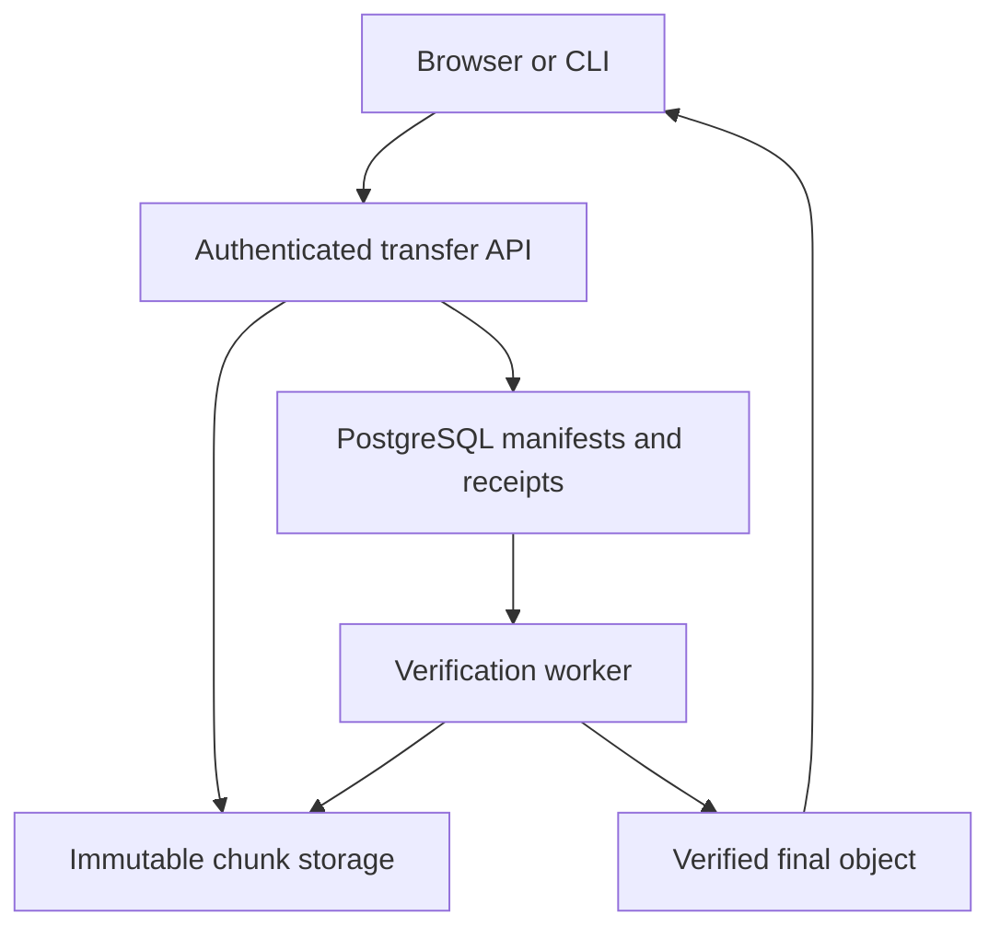
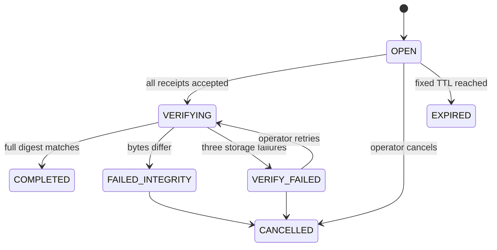

# Architecture and invariants

Relay is one Spring Boot service, one PostgreSQL database, and a storage adapter. Browser and Python CLI are clients.

## Contracts

1. Progress counts committed accepted receipts, not attempted network bytes.
2. A manifest fixes original size/digest, chunk layout, and storage adapter.
3. The first accepted digest and immutable key cannot be replaced. Identical retry returns a duplicate receipt; different bytes return 409.
4. Incoming exact length and SHA-256 pass before a receipt commits.
5. Ordered stored parts produce the declared full SHA-256. The assembled object is independently re-read and hashed again before `COMPLETED` commits.
6. Only `COMPLETED` on the original adapter permits download.

## Upload and transaction boundary

One of four in-process permits admits a request. A 64 KiB buffer copies it into a random staging file while hashing, outside a database transaction. Declared and actual lengths must independently match the manifest.

A transaction then takes `FOR SHARE` on the parent and `FOR UPDATE` on the part. Different part numbers can proceed concurrently. Status, expiry, and duplicate digest are rechecked. The adapter writes a new immutable object, then SQL writes its receipt and audit event.

Storage and SQL do not share one transaction. Storage success followed by rollback can leave an orphan key. Its UUID cannot overwrite an accepted part and it does not count as progress. Prefix cleanup after expiry, cancellation, or completion removes it. Original names never become storage paths.

This version holds the database transaction across the bounded storage write. That avoids upload lease expiry and stale writers, but occupies a connection during I/O. Storage calls have timeouts; concurrency is bounded per process, not globally across multiple instances.

## Finalization

`POST complete` commits `VERIFYING`. The worker claims a due row with `FOR UPDATE SKIP LOCKED` and retains that transaction while verifying and assembling. Another worker skips the row. Process death releases the lock and rolls back to the previously committed `VERIFYING` state.

The worker re-hashes each part and the ordered concatenation, checks the original full digest, assembles, and re-reads the final object's exact bytes. Status, digest, and final event commit together. A crash after assembly but before SQL commit leaves an unpublished object. Stable destination keys and immutable accepted parts make reassembly safe; download remains locked until commit.

Transient storage failures back off for 5 and 10 seconds, stopping after three attempts. An operator may requeue `VERIFY_FAILED`. Integrity failure is terminal for that manifest; investigate and create a new manifest with the correct original instead of silently changing its expected hash.

## Adapters

| Boundary           | Local                                                       | S3                                                    |
| ------------------ | ----------------------------------------------------------- | ----------------------------------------------------- |
| Accepted part      | Random immutable file                                       | Random immutable object                               |
| Assembly           | Ordered streaming copy, sync, same-filesystem atomic rename | Native multipart upload with ordered `UploadPartCopy` |
| Final validation   | Exact-length read and full SHA-256                          | GET final object and compute full SHA-256             |
| Restart dependency | Database and byte-storage volumes                           | Database and same bucket/prefix                       |
| Cleanup            | Staging prefix removed                                      | Paginated staging-prefix deletion                     |

Non-final chunks are at least 5 MiB; defaults are 8 MiB. Maximum part count is 10,000. ETags are storage receipts, never complete-file hashes. Configure an S3 lifecycle rule to abort incomplete MPUs: a process killed before abort can leave one outside ordinary object listings.

## Cleanup and retained audit

Open sessions expire 24 hours after creation by default, rather than after inactivity. Work queued for verification before expiry can finish afterward. Cancel admits `OPEN`, `VERIFY_FAILED`, and `FAILED_INTEGRITY`; a finalizer already holding its transaction may finish.

Completed transfers retain the final object and audit metadata while staged chunks are removed. Cancelled/expired transfers also discard unpublished final objects. Receipts remain even when their staged bytes are gone. The janitor removes `upload-*.tmp` older than 48 hours. Crash-left local `assembly-*.tmp` files require operator cleanup with the service stopped.

Completed objects have no automatic retention deletion. Admission is not disk reservation or quota; back up PostgreSQL and objects together.

## Browser boundary

Pages serves the shared UI with `data-mode="browser"`. A separate adapter commits actual chunk Blobs and receipts together in IndexedDB, hashes actual bytes, assembles a Blob, and compares the full digest before download. Original hashing uses a worker with fixed-size SHA-256 state.

Sandbox limits: 1 MiB chunks, 64 MiB files, browser-managed storage retention, no Java/PostgreSQL/S3. Blob construction may be buffered internally by the browser. Java heap measurements do not apply to it. Reload preserves stored chunks; seeded synthetic originals are reproducible. Personal files must be reselected and their complete fingerprint matched.

## Production boundaries

Multi-user isolation, tenant quotas, storage versioning, credential rotation, virus scanning, public TLS/authentication, distributed admission, large-workload scheduling, power-loss recovery, and disaster recovery are outside this local project. Infrastructure is operator-controlled; out-of-band mutation after verification is outside the download guarantee. Clients independently hash downloaded files.

Primary references: [S3 limits](https://docs.aws.amazon.com/AmazonS3/latest/userguide/qfacts.html), [AWS Java streaming](https://docs.aws.amazon.com/sdk-for-java/latest/developer-guide/best-practices-s3-uploads.html), [PostgreSQL row locks](https://www.postgresql.org/docs/16/explicit-locking.html#LOCKING-ROWS).
